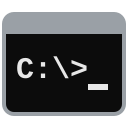

&nbsp;&nbsp;&nbsp;&nbsp;

###

###

<h1 data-importer="text" align="center">Hi there 👋, I'm Nathan Carvalho da Cunha</h1>

###

<h3 data-importer="text" align="left">👨‍💻 About Me</h3>

###

I'm a Systems Development technical student from Brazil 🇧🇷 who loves building full stack web apps and connecting software to hardware.  - 🎓 I'm studying High School + Technical Course in Systems Development (graduating Dec 2026) - 💼 I'm working as a Young Apprentice (Administrative Assistant) in the paper industry - 🚀 My final project (TCC) is <a href="https://rehabit.com.br">Rehabit</a>: a physiotherapy tracking system integrated with an ESP32 digital goniometer - 🌱 I'm currently learning Java & Spring Boot, cybersecurity and IoT - 📜 Certifications: Cisco Cybersecurity (Intro & Intermediate), SQL Databases, Power BI, JavaScript and Python

###

<h3 data-importer="text" align="left">🛠 Language and tools</h3>

###

###

<h3 data-importer="text" align="left">🏅 Badges</h3>

###

&nbsp;&nbsp;&nbsp;

###

<h3 data-importer="text" align="left">🔥 My Stats :</h3>

###

###

###

<picture data-importer="pacman">
<source media="(prefers-color-scheme: dark)" srcset="https://raw.githubusercontent.com/NathanCarvalhodaCunha/NathanCarvalhodaCunha/pacman-output/pacman-contribution-graph-dark.svg?game=pacman">
<source media="(prefers-color-scheme: light)" srcset="https://raw.githubusercontent.com/NathanCarvalhodaCunha/NathanCarvalhodaCunha/pacman-output/pacman-contribution-graph.svg?game=pacman">

</picture>

###
